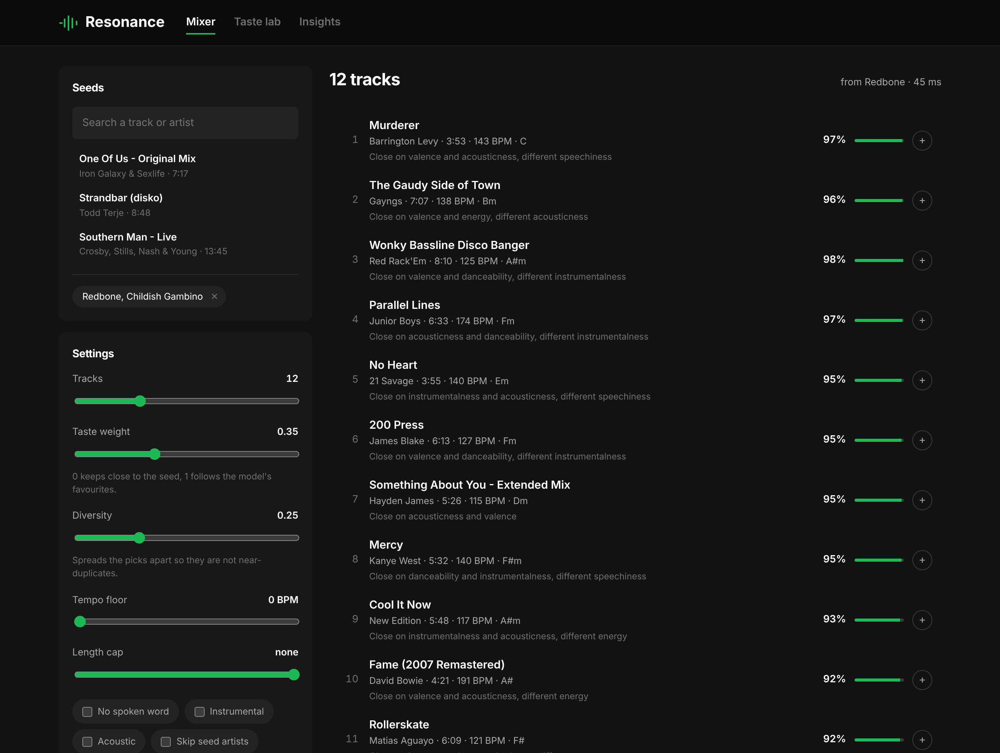
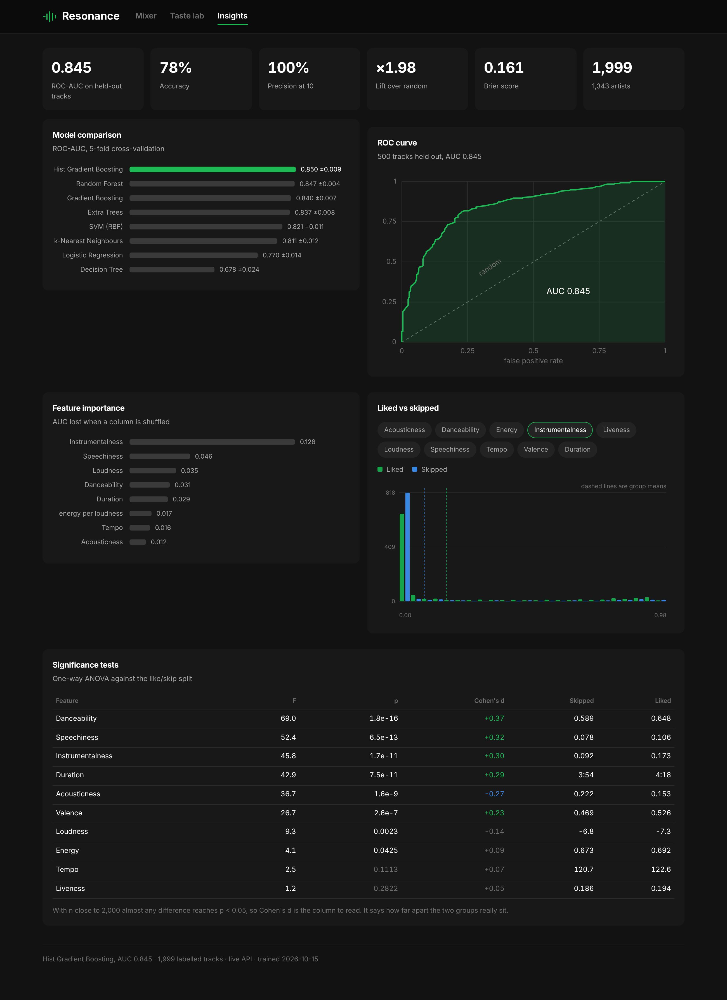

# Resonance

A music recommender built on Spotify audio features. You give it a track you
like, it gives you a playlist, and it tells you why each song is in there.

[](https://github.com/aApex1s/resonance/actions/workflows/ci.yml)
[](https://www.python.org/)
[](https://scikit-learn.org/)
[](https://fastapi.tiangolo.com/)
[](LICENSE)



## The idea

The dataset is 2,017 tracks that one listener labelled as liked or skipped.
The usual exercise is to train a classifier on it, which works fine (about
0.85 AUC), but a classifier on its own cannot build a playlist. Rank every
track by `P(like)` and you get the same list every time, no matter what you
were listening to.

So Resonance scores candidates two ways and lets you decide how much each one
counts:

```
score = (1 - w) * similarity(candidate, seeds) + w * P(like | candidate)
```

At `w = 0` you get the nearest neighbours of your seed, which tends to mean ten
versions of the same song. At `w = 1` you get the listener's favourites and the
seed barely matters. Around 0.35 is where it gets interesting. A second pass
(Maximal Marginal Relevance) spreads the picks out so the playlist doesn't
collapse into near-duplicates.

More on the design in [docs/architecture.md](docs/architecture.md).

## Getting started

```bash
git clone https://github.com/Apex1s/resonance.git
cd resonance
pip install -e ".[dev]"

make serve      # dashboard and API on http://localhost:8000
```

The trained model ships with the repo, so there is nothing to train before the
first run. If you want to rebuild it from the CSV:

```bash
make train      # ~4 minutes
make snapshot   # refresh the dashboard's offline data
make test
```

There is a Dockerfile too: `make docker && make docker-run`.

From Python:

```python
from resonance import RecommendationEngine, Filters

engine = RecommendationEngine.load()
seed = engine.search("Redbone").iloc[0]["track_id"]

playlist = engine.recommend(
    [seed], k=12,
    taste_weight=0.35,
    diversity=0.25,
    filters=Filters(tempo_min=100, exclude_spoken=True),
)
print(playlist[["song_title", "artist", "tempo", "p_like", "score"]])
```

## The dashboard

Three tabs on top of the same engine:

**Mixer** picks seeds, moves the taste and diversity dials, applies filters
(tempo floor, length cap, no spoken word, instrumental only) and shows what
each recommendation matched on.

**Taste lab** has ten sliders for building a track that doesn't exist, and the
model scores it.

**Insights** shows the model comparison, the ROC curve, feature importance and
the statistical tests.

It calls the API when one is running. When there isn't one, it loads a 500 KB
snapshot and does the same ranking in the browser, which is why it can also be
hosted as a plain static page (see `.github/workflows/pages.yml`).

## Results

Eight models, same preprocessing, 5-fold stratified cross-validation:

| Model | CV ROC-AUC | Accuracy | F1 |
|---|---|---|---|
| **Hist Gradient Boosting** | **0.850 ± 0.009** | 0.772 | 0.774 |
| Random Forest | 0.847 ± 0.004 | 0.763 | 0.764 |
| Gradient Boosting | 0.840 ± 0.007 | 0.757 | 0.754 |
| Extra Trees | 0.837 ± 0.008 | 0.760 | 0.755 |
| SVM (RBF) | 0.821 ± 0.011 | 0.739 | 0.729 |
| k-Nearest Neighbours | 0.811 ± 0.012 | 0.729 | 0.694 |
| Logistic Regression | 0.770 ± 0.014 | 0.711 | 0.702 |
| Decision Tree | 0.678 ± 0.024 | 0.678 | 0.678 |

The top three get a grid search, and the winner is wrapped in isotonic
calibration if that improves the Brier score (here it does, 0.166 to 0.161).
That step matters because the probability is added to a similarity term, so it
has to mean something on its own.

On the 500 held-out tracks: **ROC-AUC 0.845**, accuracy 78.4%, F1 0.794,
Brier 0.161. Confusion matrix 184 / 64 / 44 / 208.

Precision@10 is 1.00 and precision@50 is 0.96, against a 50.4% base rate. That
is the number worth quoting for a recommender: AUC describes the whole ranking,
but a user only ever sees the top of it.

### What drives the predictions

Permutation importance on the test split, next to the ANOVA effect sizes:

| Feature | Importance | Cohen's *d* |
|---|---|---|
| `instrumentalness` | 0.126 | +0.30 |
| `speechiness` | 0.046 | +0.32 |
| `loudness` | 0.035 | -0.14 |
| `danceability` | 0.031 | +0.37 |
| `duration_ms` | 0.029 | +0.29 |

Vocals or no vocals is the strongest signal by a wide margin. With n ≈ 2,000
nearly everything clears p < 0.05, so the reports carry Cohen's *d* and a
Benjamini-Hochberg flag next to every p-value.



## API

`make serve`, then open `/docs` for Swagger. Full reference in
[docs/api.md](docs/api.md).

| Method | Path | Does |
|---|---|---|
| `GET` | `/api/tracks?q=` | search the catalog |
| `GET` | `/api/tracks/{id}/similar` | content-based neighbours |
| `POST` | `/api/recommend` | hybrid playlist from seeds, with filters |
| `POST` | `/api/predict` | score an audio profile |
| `GET` | `/api/stats`, `/api/insights` | metrics and statistical tests |

```bash
curl -X POST localhost:8000/api/recommend \
  -H 'Content-Type: application/json' \
  -d '{"seed_ids":["08cb6b5d2e9d"],"k":10,"taste_weight":0.35,
       "diversity":0.25,"filters":{"tempo_min":110,"exclude_spoken":true}}'
```

A request takes about 11 ms.

## A few notes on the build

Audio features get described twice, on purpose. The classifier sees 38
dimensions with one-hot keys and engineered ratios. Similarity search sees 10
dimensions, quantile-ranked so that `duration_ms` in the tens of thousands
doesn't drown out `valence` between 0 and 1, then weighted by how much each
attribute should actually pull a neighbourhood.

Other things worth knowing:

- The CSV is validated on load, so a wrong file fails with a named column
  instead of a `KeyError` further down.
- `track_id` is a hash of title and artist, so ids survive a re-export.
- Scalers and encoders live inside the `Pipeline`, so cross-validation fits
  them fold by fold and nothing leaks.
- CI retrains, boots the API, calls it, and fails if AUC drops below 0.80.
- 42 tests cover the pipeline, the ranking and the HTTP contract.

## Dataset

2,017 tracks from the Spotify Web API audio-features endpoint, 1,999 after
de-duplication, with one listener's like/skip label. Columns and provenance in
[data/README.md](data/README.md).

Worth being precise about: `target` is one person's taste, not chart
popularity. The model learns a listener, and the recommender ranks for that
listener.

## Where it came from

This started as a statistical study of Spotify audio features
([docs/rapport-analyse-statistique.pdf](docs/rapport-analyse-statistique.pdf),
EMINES, May 2025) by Ammar Haddad, Anas Sabbahi and Othmane Tahfi, supervised
by Lahcen Douge and Mohammed El Machkouri. The original notebook is kept as-is
in `notebooks/`.

The study ended at the classifier. This repo picks up its conclusions about
which features matter and builds the recommender they were pointing at.

## What's next

- Thumbs up/down during a session, refitting the taste model as you go
- Playlist order as a transition model rather than a ranked set
- Spotify OAuth so anyone can seed from their own library
- Approximate nearest neighbours once the catalog passes ~100k tracks

## License

MIT, see [LICENSE](LICENSE). The dataset is included for reproducibility, the
audio is not.
