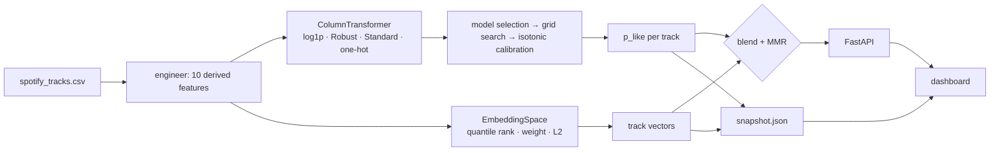

# Architecture

## Why two scores instead of one

A classifier alone cannot build a playlist. Rank 1,999 tracks by `P(like)` and
everyone gets the same list, whatever they seeded it with. The model knows the
listener but not the moment.

Similarity alone has the opposite failure: the ten nearest neighbours of a track
are ten versions of that track, including the ones the listener skipped.

Resonance keeps both and exposes the trade-off as a dial:

```
score(candidate) = (1 − w) · sim_scaled(candidate, seeds) + w · P(like | candidate)
```

* `w = 0`: pure content retrieval, the seeds decide everything
* `w = 1`: pure taste, the seeds only break ties
* `w ≈ 0.35`: the default, the neighbourhood sets the candidate pool and the
  taste model picks winners inside it

`sim_scaled` is min-max rescaled **over the surviving candidates**, not globally.
Cosine similarities in a ten-dimensional space are bunched in a narrow band
(0.93–0.99 is typical), and without rescaling the `P(like)` term would dominate
every blend above `w = 0.1`.

## The two feature spaces

The same raw columns feed two different representations, which is deliberate.

| | Taste model | Similarity space |
|---|---|---|
| Built in | `features.build_preprocessor()` | `features.EmbeddingSpace` |
| Dimensions | 38 (after one-hot) | 10 |
| Scaling | log1p + Robust / Standard | quantile rank → `[0, 1]` |
| Categorical | one-hot `key`, `mode`, `time_signature` | excluded |
| Weighting | learned by the model | hand-set per dimension |

The model needs variance and interactions, so it gets everything including
engineered ratios. Similarity needs *perceptual* distance, so each dimension is
quantile-ranked first, because otherwise `duration_ms` (tens of thousands) silently
swamps `valence` (0 to 1), and then weighted by how much that attribute should
drive a neighbourhood. Danceability, energy and valence carry weight 1.0;
liveness and duration carry 0.3.



## Diversity: MMR

Ranking by score alone produces a playlist that is correct and boring. The
second stage re-ranks the top `max(6k, 60)` candidates with Maximal Marginal
Relevance:

```
pick = argmax [ (1 − λ) · score(c) − λ · max_sim(c, already_picked) ]
```

`λ` is the `diversity` parameter. At 0 the re-ranking is skipped entirely; at
0.8 the playlist spreads across the feature space and mean similarity to the
seed drops measurably, and `test_diversity_spreads_the_playlist` asserts exactly
that.

## Calibration

The blend adds a similarity term to a probability, so the probability has to
mean something on an absolute scale. Tree ensembles are usually over-confident,
so the winning pipeline is wrapped in `CalibratedClassifierCV(method="isotonic",
cv=5)` and kept only if the Brier score improves. On the current run it does:
0.166 → 0.161, so the calibrated model ships.

## Explanations

Every recommendation carries its reasons. For each similarity dimension the
engine compares the candidate to the seed centroid in units of the catalog
standard deviation:

```
agreement = exp(−|value − seed_mean| / σ) · weight
```

The three strongest agreements become *match* chips. The dimension with the
largest weighted gap becomes a *contrast* chip. The way the track differs is
usually what makes it worth hearing after the seed, and hiding it would be a
worse explanation.

## Offline mode

The dashboard prefers the API. When there is no API (a static host, a shared
link), it loads `snapshot.json` and reproduces the ranking in the browser: the
same vectors, the same blend, the same MMR loop (`rankLocal` in `index.html`
mirrors `RecommendationEngine._rank`).

One thing cannot cross over: scikit-learn itself. Scoring a *hand-built* profile
needs the model, so offline the dashboard estimates it as a similarity-weighted
average of `p_like` over the 25 nearest real tracks, and says so on screen.
Recommendations from real seeds are unaffected: `p_like` for catalog tracks is
precomputed at training time and travels in the snapshot.

## Layout

```
src/resonance/
├── config.py            paths, schema, feature groups, weights (one source of truth)
├── data.py              loading, schema validation, stable IDs, dataset summaries
├── features.py          engineered features, the sklearn pipeline, EmbeddingSpace
├── stats.py             ANOVA, chi², Cramér's V, Cohen's d, Benjamini-Hochberg
├── train.py             selection → tuning → calibration → evaluation → artefacts
├── recommender.py       retrieval, blending, filters, MMR, explanations
├── export_snapshot.py   bundles catalog + vectors + metrics for the browser
└── api/
    ├── main.py          FastAPI routes, lifespan-loaded engine
    ├── schemas.py       pydantic request/response contracts
    └── static/          the dashboard (one HTML file) + snapshot.json
```

`config.py` is imported by everything else and nothing imports upwards from it,
so a feature added there reaches the pipeline, the API and the dashboard in one
edit.
